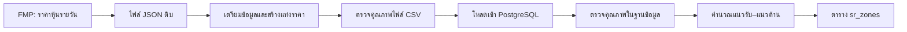

# Stock Data Pipeline และการหาโซนแนวรับ–แนวต้าน

โปรเจกต์ Python สำหรับดึงข้อมูลราคาหุ้นรายวันจาก Financial Modeling Prep (FMP) ตรวจคุณภาพข้อมูล จัดเก็บลง PostgreSQL และคำนวณโซนแนวรับ–แนวต้านจากราคาในอดีต

> โปรเจกต์นี้ทำเพื่อการเรียนรู้และเป็นผลงาน portfolio ผลวิเคราะห์ไม่ใช่คำแนะนำในการลงทุน

## โปรเจกต์ทำอะไรบ้าง

1. ดึงข้อมูลราคาเปิด/สูงสุด/ต่ำสุด/ปิด และปริมาณซื้อขายรายวันจาก FMP
2. เก็บข้อมูลดิบเป็นไฟล์ JSON
3. ทำความสะอาดและสร้างแท่งราคาในหลายช่วงเวลา ได้แก่ รายวัน รายสัปดาห์ รายเดือน รายไตรมาส ครึ่งปี และรายปี
4. ตรวจคุณภาพข้อมูลก่อนและหลังโหลดเข้า PostgreSQL
5. โหลดข้อมูลลง PostgreSQL โดยใช้การ upsert: ถ้าพบหุ้น ช่วงเวลา และวันที่เดิม จะอัปเดตแถวเดิมแทนการเพิ่มซ้ำ
6. คำนวณโซนแนวรับ–แนวต้าน แล้วบันทึกผลลง PostgreSQL

**ปัจจุบันโปรเจกต์รองรับการทำงานกับข้อมูลรายวันและช่วงเวลาที่สร้างต่อจากข้อมูลรายวันเท่านั้น ยังไม่รองรับการใช้งานข้อมูล 1H/4H** เนื่องจากข้อจำกัดสิทธิ์และจำนวนข้อมูลของ FMP รวมถึงหุ้นบางตัวไม่มีข้อมูล intraday ที่ endpoint ส่งให้ครบ จึงไม่ควรใช้ `--with-intraday` ในการรันปกติ

## ภาพรวม pipeline



## เครื่องมือที่ใช้

- Python 3.12
- pandas และ NumPy
- PostgreSQL 17
- FMP API
- pytest และ GitHub Actions

## โครงสร้างไฟล์

```text
.
├── .github/workflows/tests.yml  # รันทดสอบอัตโนมัติบน GitHub
├── docker-compose.yml           # ตั้งค่า PostgreSQL สำหรับเครื่อง local
├── pytest.ini                   # ตั้งค่า pytest
├── requirements.txt             # ไลบรารีที่ต้องติดตั้ง
└── src/
    ├── analysis/                 # คำนวณแนวรับ–แนวต้านและสัญญาณ
    ├── ingestion/                # ดึงข้อมูลจาก FMP
    ├── load/                     # โหลดข้อมูลเข้า PostgreSQL
    ├── quality/                  # ตรวจคุณภาพข้อมูล
    ├── tests/                    # ทดสอบการแปลง ตรวจคุณภาพ และ upsert
    ├── transform/                # เตรียมข้อมูลและสร้างแท่งราคา
    └── main.py                   # จุดเริ่มต้นสำหรับรัน pipeline
```

## สิ่งที่ต้องเตรียม

- Python 3.12
- Docker Desktop หรือ Docker ที่ใช้ Docker Compose ได้
- FMP API key ที่มีสิทธิ์เรียก Historical Price EOD Full
- Git

## วิธีติดตั้ง

### 1. ดาวน์โหลดโปรเจกต์

เปิด PowerShell แล้วรัน:

```powershell
git clone https://github.com/sinzyxz/Stock-Data.git
cd Stock-Data
```

### 2. สร้าง virtual environment และติดตั้งไลบรารี

```powershell
python -m venv .venv
.\.venv\Scripts\Activate.ps1
python -m pip install --upgrade pip
python -m pip install -r requirements.txt
```

บน macOS/Linux ใช้:

```bash
python3.12 -m venv .venv
source .venv/bin/activate
python -m pip install --upgrade pip
python -m pip install -r requirements.txt
```

### 3. ตั้งค่า API key และ PostgreSQL

สร้างไฟล์ชื่อ `.env` ไว้ที่โฟลเดอร์หลักของโปรเจกต์ แล้วใส่ค่าของตัวเอง:

```dotenv
FMP_API_KEY=ใส่_api_key_ของคุณ
POSTGRES_HOST=localhost
POSTGRES_PORT=5433
POSTGRES_DB=stock_analysis
POSTGRES_USER=stock_user
POSTGRES_PASSWORD=admin
```

อย่า commit หรือ push ไฟล์ `.env` ขึ้น GitHub

Docker Compose เปิด PostgreSQL ที่พอร์ต `5433` บนเครื่อง และส่งต่อไปยังพอร์ต `5432` ใน container หากใช้พอร์ตหรือรหัสผ่านอื่น ให้แก้ค่าใน `.env` ให้ตรงกัน

### 4. เปิด PostgreSQL

รันจากโฟลเดอร์หลักของโปรเจกต์:

```powershell
docker compose up -d postgres
```

ข้อมูลในฐานข้อมูลจะเก็บใน Docker volume ชื่อ `postgres_data`

## วิธีรัน pipeline

ก่อนรัน ให้เปลี่ยนไปที่โฟลเดอร์ `src`:

```powershell
Set-Location src
python main.py
```

คำสั่งนี้รันตามลำดับ:

1. `daily` — ดึงราคาหุ้นรายวันจาก FMP และบันทึก JSON ดิบ
2. `build` — เตรียมข้อมูลและสร้างแท่งราคารายวัน รายสัปดาห์ รายเดือน รายไตรมาส ครึ่งปี และรายปี
3. `quality_files` — ตรวจข้อมูลใน CSV และเขียนรายงานคุณภาพ
4. `load` — โหลดข้อมูลเข้า PostgreSQL
5. `quality_db` — ตรวจข้อมูลที่โหลดใน PostgreSQL
6. `zones` — คำนวณและบันทึกโซนแนวรับ–แนวต้าน พร้อมพิมพ์สัญญาณที่เข้าเงื่อนไข

ถ้าดึงหุ้นที่กำหนดไว้ไม่สำเร็จ ขั้นตอน ingestion จะแจ้ง error และหยุดก่อนสร้าง bars เพื่อป้องกันการนำไฟล์เก่ามาใช้ต่อ

ตัวอย่างรันเฉพาะบางขั้น:

```powershell
# ดึงข้อมูลรายวันเท่านั้น
python main.py --steps daily

# สร้าง bars แล้วตรวจไฟล์ CSV
python main.py --steps build quality_files

# โหลดไฟล์ที่มีอยู่ ตรวจฐานข้อมูล แล้วคำนวณ zones
python main.py --steps load quality_db zones
```

รายชื่อหุ้นและช่วงวันที่ตั้งค่าไว้ใน `src/ingestion/ingest_prices.py`

## การตรวจคุณภาพข้อมูล

รายงานจะแยกตามหุ้นและช่วงเวลา โดยตรวจจำนวนแท่ง ช่วงวันที่ ข้อมูล OHLC ว่างหรือผิดตรรกะ ราคาที่ไม่เป็นบวก timestamp ซ้ำ volume ติดลบ ช่วงวันที่ห่างผิดปกติ และราคาที่เปลี่ยนแปลงมาก

สถานะในรายงาน:

- `OK` — ไม่พบข้อผิดพลาดหรือช่วงข้อมูลที่น่าสงสัยตามกฎที่ตั้งไว้
- `CHECK` — พบช่วงวันที่ห่างหรือราคากระโดด ควรตรวจสอบเพิ่มเติม
- `ERROR` — พบปัญหาข้อมูล เช่น OHLC ว่าง/ผิดตรรกะ ราคาไม่เป็นบวก timestamp ซ้ำ หรือ volume ติดลบ

ไฟล์รายงานชื่อ `data/quality_report.csv` อยู่ใต้ working directory ที่ใช้รันโปรแกรม ปัจจุบันรายงานจะแจ้งปัญหา แต่สถานะในรายงานยังไม่ได้สั่งให้ pipeline หยุดเอง

## ตารางใน PostgreSQL

### `price_bars`

เก็บแท่งราคา OHLCV โดยมีคีย์หลัก `(symbol, timeframe, ts)`

| คอลัมน์ | ความหมาย |
| --- | --- |
| `symbol` | รหัสหุ้น |
| `timeframe` | ช่วงเวลา เช่น `D`, `W`, `M`, `3M`, `6M`, `12M` |
| `ts` | วันที่ของแท่งราคา |
| `open`, `high`, `low`, `close` | ราคาเปิด สูงสุด ต่ำสุด และปิด |
| `volume` | ปริมาณซื้อขาย |
| `is_complete` | ระบุว่าแท่งราคาถูกมองว่าปิดสมบูรณ์แล้วหรือไม่ |

### `sr_zones`

เก็บโซนแนวรับ–แนวต้าน เช่น ประเภทโซน ขอบล่าง/ขอบบน ราคากลาง คะแนน ช่วงเวลาที่พบโซน จำนวนครั้งที่ราคาแตะ และระยะห่างจากราคาปัจจุบัน

## วิธีคำนวณแนวรับ–แนวต้าน

ระบบใช้แท่งราคาที่ปิดแล้วในแต่ละช่วงเวลา โดยย่อคือ:

1. ใช้ ATR ปรับความกว้างของช่วงราคาให้สัมพันธ์กับความผันผวน
2. นับระดับราคาจาก open, high, low และ close ที่เกิดซ้ำ
3. เลือกบริเวณที่มีการแตะหลายครั้งเป็นโซนที่มีโอกาสสำคัญ
4. ใช้ความหนาแน่นของ volume ช่วยปรับคะแนน
5. รวมโซนที่ทับซ้อนกันระหว่างช่วงเวลา และให้น้ำหนักช่วงเวลาที่ยาวกว่าสูงกว่า
6. ระบุโซนใต้ราคาปิดรายวันล่าสุดเป็นแนวรับ และโซนเหนือราคาเป็นแนวต้าน

ระบบจะแสดงสัญญาณเมื่อพบรูปแบบราคาดีดจากโซนแนวรับตามเงื่อนไขที่เขียนไว้ แต่ไม่ได้ส่งคำสั่งซื้อขาย

## ทดสอบและ GitHub Actions

รัน tests ในเครื่องจากโฟลเดอร์หลัก:

```powershell
python -m pytest -q
```

tests ครอบคลุมการเตรียมแท่งราคา กฎตรวจคุณภาพ และการ upsert เข้า PostgreSQL ส่วน GitHub Actions จะติดตั้ง dependencies เปิด PostgreSQL ชั่วคราว แล้วรัน tests อัตโนมัติเมื่อมีการ push หรือ Pull Request

## ข้อจำกัดปัจจุบัน

- โปรเจกต์เน้นข้อมูลรายวัน ยังไม่รองรับการใช้งาน 1H/4H เพราะ FMP จำกัดสิทธิ์และจำนวนข้อมูล และหุ้นบางตัวไม่มีข้อมูล intraday ที่ endpoint ใช้ได้
- การเข้าถึงข้อมูลและช่วงย้อนหลังขึ้นอยู่กับแพ็กเกจ FMP และความครอบคลุมของแต่ละหุ้น
- โค้ดตั้งช่วงขอข้อมูลรายวันตั้งแต่ `1900-01-01` ถึงวันที่รัน แต่ยังไม่ได้แบ่งคำขอเป็นช่วงย่อย FMP ระบุเพดาน 5,000 แถวต่อคำขอ ดังนั้นยังรับประกันไม่ได้ว่าจะได้ประวัติครบทั้งหมดของหุ้นที่มีข้อมูลเกินเพดาน
- daily bar ถูกกำหนดว่า complete ในขั้น build ควรรันหลังตลาดปิด หากต้องการใช้ข้อมูลรายวันล่าสุด
- รายงาน quality แสดงปัญหา แต่ยังไม่ได้หยุด pipeline ตามสถานะ `ERROR`
