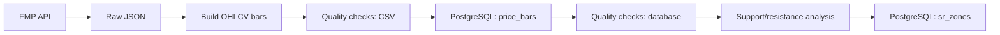

# Stock Data Pipeline & Support/Resistance Zones

A Python data engineering and market analysis project that collects historical stock prices from Financial Modeling Prep (FMP), transforms daily and optional intraday data into multiple timeframes, validates the resulting bars, loads them into PostgreSQL, and calculates support/resistance zones.

> This repository is an educational and portfolio project. Its analytical output is not investment advice.

## What it does

- Ingests daily OHLCV history for a configurable list of US-listed symbols using the FMP Historical Price EOD Full endpoint.
- Saves the API response as raw JSON before transformation.
- Builds daily, weekly, monthly, quarterly, half-yearly, and yearly bars. If intraday files are available, it also builds 1-hour and 4-hour bars.
- Runs data quality checks on CSV output and on data loaded in PostgreSQL.
- Loads bars into PostgreSQL using an upsert key of `(symbol, timeframe, ts)`, so reloading a bar updates it instead of inserting a duplicate.
- Finds support/resistance zones from completed bars, combines overlapping zones across timeframes, and prints possible entry signals.
- Writes per-step pipeline status and timestamps to a JSONL run log.

## Pipeline



The normal run skips intraday ingestion. Pass `--with-intraday` to request 1H/4H data; access to those FMP endpoints depends on the API plan.

## Tech stack

- Python 3.12
- pandas and NumPy
- PostgreSQL 17
- psycopg2
- Financial Modeling Prep API
- pytest
- GitHub Actions

## Repository layout

```text
.
├── .github/workflows/tests.yml  # CI workflow
├── docker-compose.yml           # Local PostgreSQL service
├── pytest.ini
├── requirements.txt
└── src/
    ├── analysis/                # Support/resistance and signal logic
    ├── ingestion/               # FMP client and daily/intraday ingestion
    ├── load/                    # PostgreSQL loading and upsert
    ├── quality/                 # Data quality report
    ├── tests/                   # Unit and PostgreSQL integration tests
    ├── transform/               # Input preparation and timeframe bars
    └── main.py                  # Pipeline entry point
```

## Requirements

- Python 3.12
- Docker Desktop or another Docker Compose installation
- An FMP API key with access to the historical price endpoint
- Git

## Setup

### 1. Clone the repository

```powershell
git clone https://github.com/sinzyxz/Stock-Data.git
cd Stock-Data
```

### 2. Create a virtual environment and install dependencies

PowerShell:

```powershell
python -m venv .venv
.\.venv\Scripts\Activate.ps1
python -m pip install --upgrade pip
python -m pip install -r requirements.txt
```

macOS/Linux:

```bash
python3.12 -m venv .venv
source .venv/bin/activate
python -m pip install --upgrade pip
python -m pip install -r requirements.txt
```

### 3. Configure credentials

Create a `.env` file in the repository root. Do not commit this file.

```dotenv
FMP_API_KEY=replace_with_your_fmp_api_key
POSTGRES_HOST=localhost
POSTGRES_PORT=5433
POSTGRES_DB=stock_analysis
POSTGRES_USER=stock_user
POSTGRES_PASSWORD=admin
```

The PostgreSQL port is `5433` on the host because Docker Compose maps host port `5433` to container port `5432`. Change the environment values if your local database uses different credentials or ports.

### 4. Start PostgreSQL

Run this from the repository root:

```powershell
docker compose up -d postgres
```

The database data persists in the Compose volume `postgres_data`.

## Run the pipeline

The pipeline uses paths relative to its current directory. Run it from `src/`:

```powershell
Set-Location src
python main.py
```

The default run executes these steps in order:

1. `daily` — fetch daily prices and save raw JSON.
2. `build` — prepare and create bars for each available timeframe.
3. `quality_files` — validate processed CSV files and write a quality report.
4. `load` — upsert bars into PostgreSQL.
5. `quality_db` — validate bars from PostgreSQL.
6. `zones` — calculate zones and print any matching entry signals.

If a required daily symbol fails to download, ingestion raises an error and the pipeline stops before building bars. Each completed or failed step is recorded in `src/logs/pipeline_runs.jsonl` when running from `src/`.

### Run selected steps

Run only the daily ingestion:

```powershell
python main.py --steps daily
```

Build bars and check the CSV output:

```powershell
python main.py --steps build quality_files
```

Load existing CSV bars, check the database, and calculate zones:

```powershell
python main.py --steps load quality_db zones
```

Run with optional intraday ingestion:

```powershell
python main.py --with-intraday
```

Symbols and date ranges are configured in `src/ingestion/ingest_prices.py` and `src/ingestion/ingest_intraday.py`.

## Data quality checks

The quality report groups data by symbol and timeframe. It includes the row count, completed-bar count, date range, null OHLC values, invalid OHLC relationships, non-positive prices, duplicate timestamps, zero-volume rows, large date gaps, large price changes, and whether there are enough completed bars for support/resistance analysis.

Statuses:

- `OK` — no hard errors or configured gap/jump warnings.
- `CHECK` — unusual date gaps or price changes need review.
- `ERROR` — hard data errors such as null OHLC, invalid OHLC, non-positive prices, duplicate timestamps, or negative volume.

The CSV report is written to `data/quality_report.csv`, relative to the pipeline working directory. Quality status is reported for review; the quality report itself currently does not stop the pipeline.

## PostgreSQL tables

### `price_bars`

Stores OHLCV bars by symbol and timeframe.

| Column | Meaning |
| --- | --- |
| `symbol` | Stock ticker |
| `timeframe` | `1H`, `4H`, `D`, `W`, `M`, `3M`, `6M`, or `12M` |
| `ts` | Timestamp/date of the bar |
| `open`, `high`, `low`, `close` | OHLC prices |
| `volume` | Trading volume |
| `is_complete` | Whether the bar is considered complete |

Primary key: `(symbol, timeframe, ts)`.

### `sr_zones`

Stores calculated zones, including zone type, lower/upper bounds, center, score, timeframes contributing to the zone, touch counts, distance from the reference price, and volume-density fields.

## Support/resistance method

For each timeframe, the analyzer:

1. Uses completed bars and calculates ATR to scale price bins to current volatility.
2. Counts repeated touches using OHLC price levels.
3. Builds candidate zones from nearby price bins and requires a minimum number of touches.
4. Estimates volume density inside each zone and uses it to adjust the zone score.
5. Merges overlapping zones across timeframes, giving larger timeframes higher weights.
6. Labels zones below the latest daily close as support and zones above it as resistance.

The entry-signal routine checks for a rebound pattern at a support zone after a decline. It prints signals to the terminal; it does not place trades.

## Tests and continuous integration

Run tests locally from the repository root:

```powershell
python -m pytest -q
```

The tests cover bar preparation, quality-check behavior, and PostgreSQL upsert behavior. The GitHub Actions workflow in `.github/workflows/tests.yml` runs them on every push and pull request. Its PostgreSQL service is temporary and used only for the integration test.

## Current limitations

- FMP endpoint access, symbol coverage, rate limits, and historical availability depend on the API plan.
- The daily ingestion requests `1900-01-01` through the current date, but it does not currently split this request into smaller date chunks. FMP documents a maximum of 5,000 records per request, so very long histories may require chunked ingestion to guarantee full coverage.
- Intraday ingestion is optional and may require an FMP plan that supports the requested endpoints.
- Daily bars are currently marked complete by the bar builder. For analysis during market hours, review the latest daily bar before relying on results.
- Quality reports identify issues but currently do not fail the pipeline based on report status.
